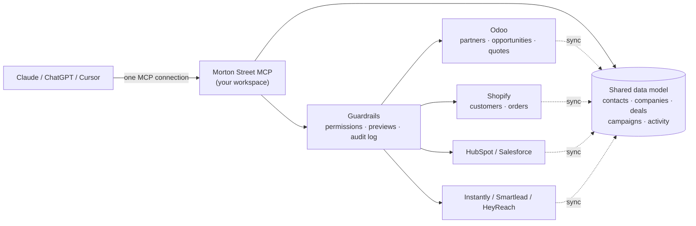
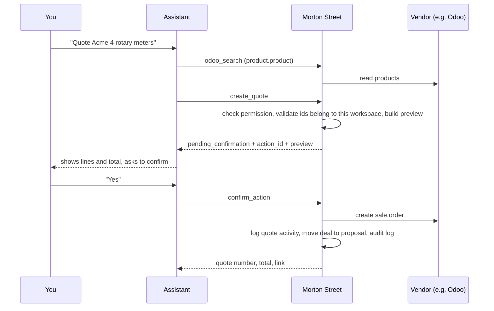

| | |
| --- | --- |
| Endpoint | `https://api.mortonstreet.ai/mcp` |
| Transport | Streamable HTTP |
| Auth | OAuth 2.1 (see [Authentication](/concepts/authentication)) |
| Metadata | `/.well-known/oauth-protected-resource/mcp` |

## Why one server

A sales team's work is spread across a CRM or ERP (Odoo, HubSpot, Salesforce), a store (Shopify), sequencers (Instantly, Smartlead, HeyReach) and email. Connecting an AI assistant to each one separately means several MCP servers, several logins, and an assistant that has to know which vendor holds which record.

Morton Street connects those tools once per workspace and gives your assistant **one** server. The assistant asks for a contact, a quote or a pipeline; Morton Street knows which system it lives in, and keeps every vendor's copy in step.

- **Reads** come from the shared data model, which is synced from every connected tool. They are fast, work across vendors (one contact can have an Odoo partner, a Shopify customer and an Instantly lead), and don't use your vendors' API quotas. Odoo reads ([`odoo_search`](/mcp/odoo#odoo_search)) go straight to Odoo, so they reach every record in your ERP, not just the synced ones.
- **Writes** go to the vendor first, then update the shared model, so Morton Street and the vendor never disagree. Every write passes through [guardrails](/concepts/guardrails).

## Every tool

**Preview** means the tool can return a preview with an `action_id` instead of running, and only runs after the user approves it (see [Approvals](/mcp/approvals)). "Workspace setting" means it previews when the workspace's permission for that scope says so, or when an assistant's call touches more than 25 records.

### Workspace

| Tool | What it does | Scope | Preview |
| --- | --- | --- | --- |
| [`whoami`](/mcp/workspace#whoami) | Who is signed in, the active workspace, and other workspaces you can switch to | none | no |
| [`switch_workspace`](/mcp/workspace#switch_workspace) | Choose which client workspace the assistant acts in | none | no |
| [`list_connections`](/mcp/workspace#list_connections) | Which tools are connected, and their sync health | none | no |
| [`sync_now`](/mcp/workspace#sync_now) | Pull fresh data from one or every connected tool | `crm.read` | no |

### Read

| Tool | What it does | Reads from | Scope |
| --- | --- | --- | --- |
| [`search_contacts`](/mcp/read#search_contacts) | Find people by name, email, title, status or tag | Shared model (all tools) | `crm.read` |
| [`get_contact`](/mcp/read#get_contact) | One person with company, deals, sequences and recent activity | Shared model | `crm.read` |
| [`search_companies`](/mcp/read#search_companies) | Find accounts by name, domain or industry | Shared model | `crm.read` |
| [`account_timeline`](/mcp/read#account_timeline) | Everything that happened with an account, across every tool | Shared model | `crm.read` |
| [`get_pipeline`](/mcp/read#get_pipeline) | Deals by stage with counts and values | Shared model | `crm.read` |
| [`list_campaigns`](/mcp/read#list_campaigns) | Sequencer campaigns | Shared model | `campaigns.read` |
| [`campaign_performance`](/mcp/read#campaign_performance) | Sent, open, reply, positive and bounce rates | Shared model | `campaigns.read` |
| [`replied_without_deal`](/mcp/read#replied_without_deal) | People who replied but have no open deal | Shared model | `crm.read` |
| [`odoo_search`](/mcp/odoo#odoo_search) | Odoo partners, opportunities, quotes, products and invoices | Odoo, live | `crm.read` |
| [`odoo_fields`](/mcp/odoo#odoo_fields) | The fields on an Odoo model, so the assistant knows what it can enrich | Odoo, live | `crm.read` |

### Write

| Tool | What it does | Writes to | Scope | Preview |
| --- | --- | --- | --- | --- |
| [`upsert_contacts`](/mcp/write#upsert_contacts) | Save or update contacts | Morton Street | `crm.write` | workspace setting |
| [`create_deal`](/mcp/write#create_deal) | Open a deal | Morton Street, optionally Odoo, HubSpot or Salesforce | `crm.write` | workspace setting |
| [`update_deal_stage`](/mcp/write#update_deal_stage) | Move a deal | The deal's CRM, then Morton Street | `crm.write` | workspace setting |
| [`log_activity`](/mcp/write#log_activity) | Record a note, call or meeting | Morton Street, optionally the CRM | `crm.write` | workspace setting |
| [`update_odoo_record`](/mcp/odoo#update_odoo_record) | Enrich or edit fields on an Odoo contact, opportunity or quote | Odoo | `crm.write` | workspace setting |
| [`create_quote`](/mcp/odoo#create_quote) | Create an Odoo quotation with product lines | Odoo, then Morton Street | `crm.write` | workspace setting |
| [`confirm_quote`](/mcp/odoo#confirm_quote) | Turn a quotation into a confirmed sales order | Odoo | `crm.write` | **always** |

### Workflows

| Tool | What it does | Touches | Scope | Preview |
| --- | --- | --- | --- | --- |
| [`push_leads_to_sequence`](/mcp/workflows#push_leads_to_sequence) | Enroll contacts in a campaign | Instantly, Smartlead or HeyReach | `campaigns.send` | yes, by default |
| [`sync_to_crm`](/mcp/workflows#sync_to_crm) | Create or update contacts in a CRM, optionally with deals | Odoo, HubSpot, Salesforce or Shopify | `crm.bulk_sync` | yes, by default |
| [`list_to_sequence_and_crm`](/mcp/workflows#list_to_sequence_and_crm) | Import a list, put it in the CRM, start the sequence | CRM + sequencer | `campaigns.send` | yes, by default |

### Approvals

| Tool | What it does |
| --- | --- |
| [`list_pending_actions`](/mcp/approvals#list_pending_actions) | Writes waiting for a human |
| [`confirm_action`](/mcp/approvals#confirm_action) | Run a previewed write after the user says yes |
| [`cancel_action`](/mcp/approvals#cancel_action) | Discard a previewed write |

## What happens on a write

1. **Permission.** The workspace's admins decide which scopes are on, and which need a preview (Settings → Permissions).
2. **Tenant check.** Every id the assistant passes in (contact, company, deal) must belong to the active workspace, or the call is refused.
3. **Preview.** The tool returns what will happen: the records, the before and after values, the totals. Nothing has changed yet.
4. **Confirm.** The exact previewed payload runs once. Approvals can also be given in the portal.
5. **Vendor, then Morton Street.** The vendor is written first; the shared model and the activity timeline are updated after.
6. **Audit.** Every read and write is recorded with who ran it, from which client, and what it did.

## Workspaces and access

Each client company is its own workspace, and every tool acts in exactly one workspace at a time.

- **Customers** are invited to their company's workspace and only ever see that workspace. Their assistant can't name, read or write another workspace's records.
- **Morton Street operators** who belong to several workspaces see the active workspace named in every tool result, and use `whoami` and `switch_workspace` to change client.

<Info>Your AI client always reads the live tool list and input schemas from the server. This reference explains what each tool does; the schemas your client sees are the source of truth for exact parameter names.</Info>
