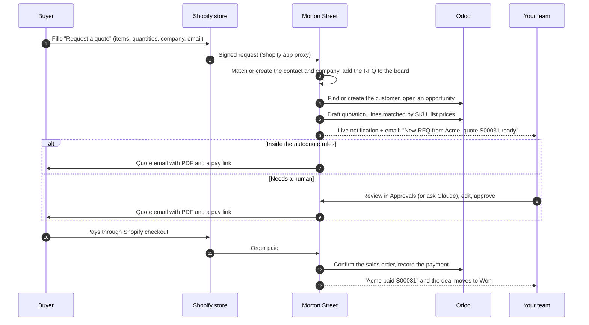

Industrial and B2B buyers rarely check out at list price. They ask for a quote. This playbook connects the store where the request starts (Shopify), the system that prices and books it (Odoo), and the email that closes it, with Morton Street in the middle so every step is tracked in one place.

<Note>
Some steps below are rolling out. The status column shows what runs today. The quote, enrichment and approval steps already work from your assistant through the [Odoo tools](/mcp/odoo).
</Note>

## The flow

| Step | What happens | Status |
| --- | --- | --- |
| Intake | A "Request a quote" block on product and cart pages posts the items and buyer details to Morton Street through a signed Shopify app proxy. | Coming soon |
| Record | The buyer is matched on email (or created) in Morton Street and in Odoo, and an opportunity is opened. | Coming soon (manual today with `sync_to_crm` and `create_deal`) |
| Quote | A draft Odoo quotation is built. Shopify variants are matched to Odoo products by SKU (Odoo's internal reference), at Odoo's list prices. | Live from your assistant (`create_quote`) |
| Notify the team | A live notification in the portal and an email to the owner or a shared sales inbox. | Coming soon |
| Approve | Quotes outside the autoquote rules wait in **Approvals** with the full preview. | Live |
| Send | The buyer gets the quote PDF and a pay link that opens a Shopify checkout for exactly the quoted lines. | Coming soon |
| Close | When Shopify reports the order paid, the Odoo sales order is confirmed and the deal moves to Won. | Coming soon (confirm today with `confirm_quote`) |

## Autoquote rules

Each workspace decides when a quote can go out without a person looking at it. A request that breaks any rule waits in Approvals instead.

| Rule | Example |
| --- | --- |
| Every requested item matched to an Odoo product | No unknown SKUs or free-text items |
| Total under a limit | Under $10,000 |
| Known buyer | Existing Odoo customer, or an email on the company's domain |
| Quantity limits | No line above 25 units |
| Business hours | Send immediately 8am to 6pm; otherwise queue for the morning |

Out of the box, every RFQ waits for approval. Turn autoquote on per workspace once the rules match how you price.

## The RFQ board

Every request is a card that moves on its own as Odoo and Shopify change:

**New RFQ** → **Quote drafted** → **Quote sent** → **Paid** → **Fulfilled**

Each card links to the Odoo opportunity and quote, the Shopify order, and the email thread, and its history is on the account's timeline (`account_timeline`).

## Doing it from your assistant today

> A buyer at Acme emailed asking for 4 of the 3" rotary meters. Quote them and log it.

1. `search_contacts` for the buyer (or `upsert_contacts` then `sync_to_crm` with `provider: "odoo"` if they're new).
2. `odoo_search` on `product.product` with `query: "rotary"` for the product id and list price.
3. `create_quote` with the contact and the line, then approve the preview.
4. When they've paid, `confirm_quote`, and `update_deal_stage` to `won`.

## What you need

- [Odoo](/integrations/odoo) connected, with Sales installed and products carrying an internal reference that matches the Shopify SKU.
- [Shopify](/integrations/shopify) connected. For intake, the Morton Street app installed with its "Request a quote" block added to your theme.
- A sending domain for notification and quote emails (see your workspace's email settings when available).
